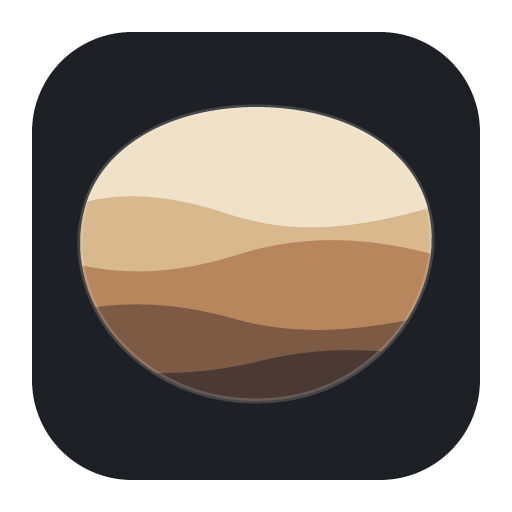
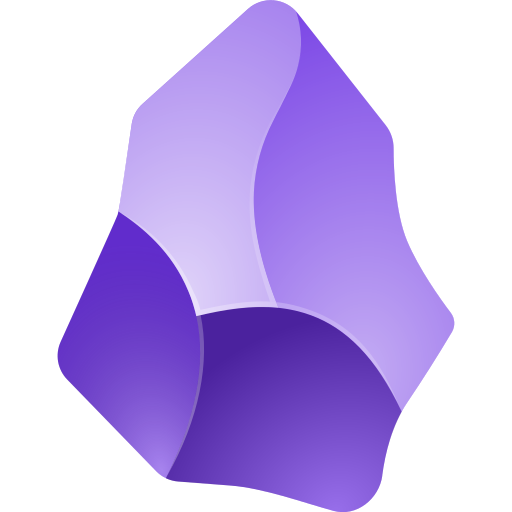

<p align="center"></p>
<p align="center"><sub>Inspired by <a href="https://obsidian.md"> Obsidian</a>. Bedrock is an independent open-source project and is not affiliated with or endorsed by Obsidian or Dynalist Inc.</sub></p>

# Bedrock notes app

**Bedrock by Toolbay** is a free, open-source notes app for plain Markdown files on your own
computer, with sync to your other computers built in. It opens your existing Obsidian vaults and
works with their themes, snippets and community plugins.

- Notes are ordinary `.md` files in a folder. Nothing is locked in.
- Links between notes (`[[like this]]`), embeds, tags, properties, callouts, math, diagrams.
- Live preview while you type, a source mode, and a reading view.
- Tabs, splits, stacked tabs, pinned tabs, a file explorer, a quick switcher and a command palette.
- Your vault syncs end-to-end encrypted when you're signed in to Toolbay. Signed out, everything
  works offline.
- Free. No plans, limits, trials or telemetry.

## Install

Get it from the Toolbay app, or download the latest installer from
[Releases](https://github.com/sriptcollector/bedrock/releases): `Bedrock_<version>_x64-setup.exe`
on Windows (installs for your user, no admin prompt), `.dmg` on macOS.

On first start Bedrock makes your vault at `Documents\Bedrock` with a short welcome note. To use an
existing Obsidian vault, go to Settings › General › Advanced and either open it as a separate vault
or import it into your synced vault.

## Connect an AI agent

AI apps such as Claude Code, Claude Desktop, Cursor and VS Code can search, read and edit your
notes. It's on by default and only works on your own computer.

1. Open **Settings › Connect an AI agent**.
2. Click **Connect** next to Claude Code, Claude Desktop or Cursor. (Restart Claude Desktop or
   Cursor afterwards.) For other apps, copy the setup shown under **Other apps**.
3. Ask your agent things like "find my notes about the garden and add today's ideas to my daily
   note".

What agents can do: full-text search (the same search language as the app), read notes, create,
edit (whole note, find and replace, or one section under a heading), append, rename or move with
links updated everywhere, delete (to the vault's `.trash` folder, never permanently), list notes
and folders, backlinks and outgoing links, tags, find notes by their properties, set a property,
get or create today's daily note, and, while the app is open, see and open the note you're looking at.

Their edits are ordinary edits: they show up in open notes right away, sync to your other
computers and keep version history. Agents reach your notes only on this computer, through a
helper the agent app starts itself or through `http://127.0.0.1` with a private token. Turn it off
any time with the switch at the top of that settings page.

Terminals and coding agents can also use the `bedrock` command (installed with the app on
Windows; on macOS click **Install command line tool** in the same settings page):

```
bedrock search "meeting tag:#work"      bedrock read "Projects/Plan"
bedrock new "Inbox/Idea" --content "…"  bedrock append "Log" "Called Sam"
bedrock daily --append "- shipped it"   bedrock mv "Draft" "Archive/Draft"
bedrock tags                            bedrock backlinks "Plan"
bedrock props status=active "due<2026-12-01"
bedrock open "Plan"                     bedrock mcp      (stdio MCP server)
```

Add `--json` to any command for JSON output. Full reference, the REST API and its OpenAPI file:
[docs/AGENT-API.md](docs/AGENT-API.md).

## Build from source

```
npm install
npm start -w app        # run
npm test -w app         # unit tests
npm run dist -w app     # installer
```

Contributor rules: [AGENTS.md](AGENTS.md). Code layout: [app/README-DEV.md](app/README-DEV.md).
Design: [docs/ARCHITECTURE.md](docs/ARCHITECTURE.md).

---

<sub>Inspired by Obsidian. Bedrock is an independent open-source project and is not affiliated with
or endorsed by Obsidian or Dynalist Inc. MIT licensed, © Toolbay contributors.</sub>
