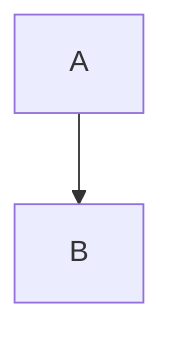

# Welcome to the test vault

This note has **bold**, *italic*, ~~strike~~, ==highlight== and `inline code`.
Links: [[Projects/Alpha|the Alpha project]], [[Beta]], [[Beta#Goals]], [[Missing note]] and [an external link](https://example.com).
Tags: #demo #nested/tag

## Tasks
- [ ] Write the plan
- [x] Set up the vault
- A plain bullet
  - Nested bullet ^bullet-id

1. First
2. Second

> [!note] A callout
> Callouts are rendered in live preview and reading view.

> [!warning]- Folded warning
> Hidden until opened.

| Name | Value |
| ---- | ----- |
| one  | 1     |
| two  | 2     |

Inline math $e^{i\pi} + 1 = 0$ and a block:

$$
\int_0^1 x^2\,dx = \frac{1}{3}
$$

```js
function hello(name) {
  return `hi ${name}`;
}
```



%% a hidden comment %%

Footnote reference[^1].

![[Beta#Goals]]

![[pixel.png]]

---

A paragraph with a block id. ^para-id

[^1]: The footnote text.
